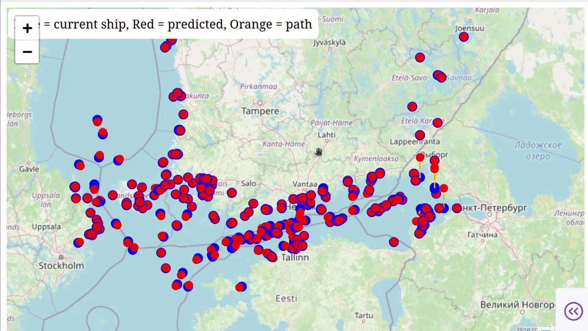
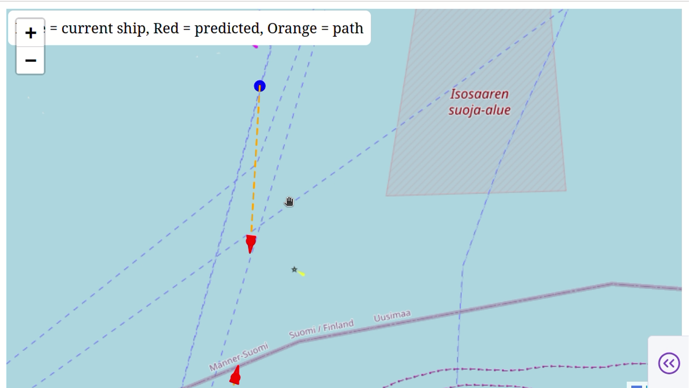

# AIS Vessel Tracking & Prediction — dep_26_group_14

A real-time data engineering pipeline that collects live ship positions from the Finnish
[Digitraffic Marine API](https://www.digitraffic.fi/en/marine-traffic/), stores them in PostgreSQL,
predicts where each vessel will be in the near future, and serves the results through a
Flask REST API to a map-based web dashboard.

## Screenshots

<!-- Replace the paths below with your own images (e.g. put them in documentation/screenshots/) -->

### dashboard 



_zoomed out image of the dashboard , showing boats in Finnish marine borders._

### 



_zoomed in image , showing ship predicted direction._

## working of the project

```
Ships (AIS radio) ──► Digitraffic MQTT broker ──► websocket.py ──► PostgreSQL ──► flask_api.py ──► Dashboard
                      meri.digitraffic.fi:443     (subscriber)     table: jsona    (REST API)       (index.html)
```

1. **Ingestion** — [websocket.py](websocket.py) connects to the Digitraffic MQTT broker over secure
   WebSockets and subscribes to `vessels-v2/+/location`, which streams position updates for all vessels.
   Each message is parsed and placed in an in-memory queue.
2. **Storage** — a background worker thread in the same script takes messages from the queue and
   inserts them into the PostgreSQL table `jsona`.
3. **Prediction** — [flask_api.py](flask_api.py) takes each vessel's latest position, speed over
   ground (SOG) and course over ground (COG) and uses dead reckoning to estimate its position
   _N_ minutes ahead (assumes constant speed and heading).
4. **API** — Flask exposes the latest vessel states and predictions as JSON.
5. **Visualization** — [index.html](index.html) / [index.js](index.js) show vessels on a Leaflet
   (OpenStreetMap) map with history and predicted-path lines.

### Collected data fields

| Column    | Meaning                                    |
| --------- | ------------------------------------------ |
| `mmsi`    | Unique vessel identifier                   |
| `time`    | Timestamp of the position report (epoch s) |
| `lat/lon` | Latitude / longitude                       |
| `sog`     | Speed over ground (knots)                  |
| `cog`     | Course over ground (degrees)               |
| `heading` | Direction the bow is pointing (degrees)    |
| `navstat` | Navigational status                        |
| `rot`     | Rate of turn                               |
| `posacc`  | Position accuracy flag                     |
| `raim`    | RAIM (receiver integrity) flag             |

## Project structure

```
├── websocket.py              # MQTT subscriber → PostgreSQL ingestion
├── flask_api.py              # REST API with latest positions and predictions
├── index.html / index.js / style.css   # Leaflet map dashboard
├── ingestion_service/        # Earlier prototypes of ingestion + prediction (great-circle formula)
└── documentation/            # Data pipeline, API endpoints, data management plan, diagram
```

More detail:
- [documentation/data_pipeline.md](documentation/data_pipeline.md) — MQTT/WebSocket data flow
- [documentation/api_endpoints.md](documentation/api_endpoints.md) — API endpoints and prediction math
- [documentation/Data_Management_Plan.md](documentation/Data_Management_Plan.md) — data management plan

## Setup

### Prerequisites

- Python 3.9+
- PostgreSQL 13+ (running locally on port 5432)
- A modern web browser
- Internet access (to reach `meri.digitraffic.fi`)

### 1. Clone the repository

```bash
git clone https://git.dc.turkuamk.fi/de-project/dep_26_group_14.git
cd dep_26_group_14
```

### 2. Create a virtual environment and install dependencies

```bash
python -m venv venv

# Windows
venv\Scripts\activate
# macOS / Linux
source venv/bin/activate

pip install flask psycopg2-binary paho-mqtt
```

### 3. Create the database and table

Open `psql` (or pgAdmin) and run:

```sql
CREATE DATABASE new1;
\c new1

CREATE TABLE jsona (
    id       SERIAL PRIMARY KEY,
    mmsi     BIGINT,
    time     BIGINT,
    sog      DOUBLE PRECISION,
    cog      DOUBLE PRECISION,
    navstat  INTEGER,
    rot      DOUBLE PRECISION,
    posacc   BOOLEAN,
    raim     BOOLEAN,
    heading  INTEGER,
    lon      DOUBLE PRECISION,
    lat      DOUBLE PRECISION
);

CREATE INDEX idx_jsona_mmsi_time ON jsona (mmsi, time DESC);
```

### 4. Configure database credentials

The connection settings are currently hard-coded. Update them to match your PostgreSQL setup in:

- `DB_CONFIG` in [flask_api.py](flask_api.py)
- `psycopg2.connect(...)` in [websocket.py](websocket.py)

## Running the project

Each component runs in its own terminal (activate the virtual environment in each).

### 1. Start data ingestion

```bash
python websocket.py
```

You should see `DB worker started` and `Connected`. Rows will start appearing in the `jsona`
table within seconds. Press `Ctrl+C` to stop.

### 2. Start the API

```bash
python flask_api.py
```

The API runs at `http://127.0.0.1:5000`. Try it:

| Endpoint                                    | Description                                         |
| ------------------------------------------- | --------------------------------------------------- |
| `GET /api/health`                           | Health check — returns `{"status": "ok"}`           |
| `GET /api/vessels/latest`                   | Latest row for every vessel                         |
| `GET /api/vessels/predictions?minutes=15`   | Latest position + predicted position (default 10 min) |

```bash
curl http://127.0.0.1:5000/api/vessels/predictions?minutes=15
```

### 3. Open the dashboard

Open [index.html](index.html) in your browser (double-click it, or serve the folder with
`python -m http.server 8080` and visit `http://localhost:8080`).

> **Note:** the dashboard currently starts in **Mock mode**, which shows simulated vessels without
> needing a backend. Connecting it to the Flask API (endpoint paths and port 5000) is still in progress.

## Team

Group 14 — Data Engineering Project 2026, Turku University of Applied Sciences.
