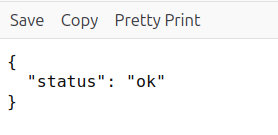
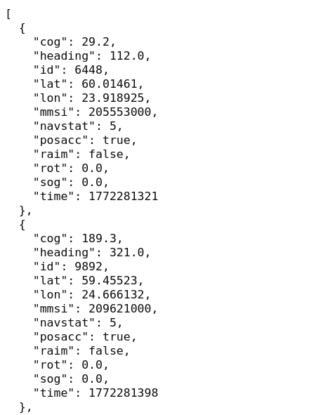
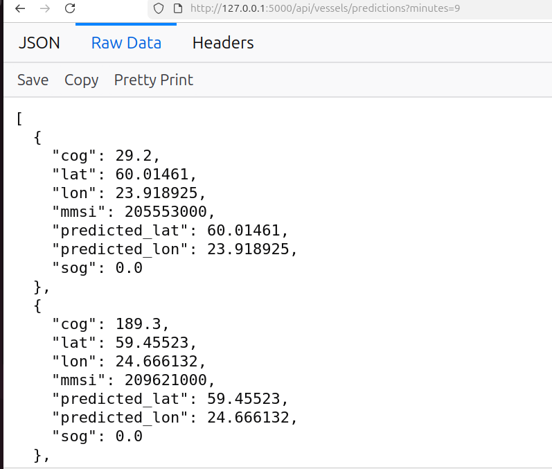

# AIS Flask API documentation

the flask_api.py file creates a simple Flask API that reads AIS vessel data from PostgreSQL and exposes three endpoints.

The API does two main queryable endpoints :

1. returns the latest AIS row for each vessel  `/api/vessels/latest`
2. returns the latest AIS row for each vessel together with a simple predicted future position  `/api/vessels/predictions`

## Endpoints

### 1. `GET /api/health`

This is a basic health check endpoint.

output :



quick test to see whether the backend is alive


### 2. `GET /api/vessels/latest`

result :



- one unique mmsi  
- with the corresponding column values from the latest timestamp row  

This endpoint returns the latest full selected AIS row for each vessel.


What it does:

- reads vessel data from the AIS table  
- returns only one row per vessel  
- that row is the newest row for that vessel  


The SQL query uses:

```
SELECT DISTINCT ON (mmsi)
...
ORDER BY mmsi, time DESC
```

- `DISTINCT ON (mmsi)` keeps only one row for each vessel id  
- `ORDER BY mmsi, time DESC` sorts rows so that the newest row for each mmsi comes first  


This is useful when the frontend needs the newest known vessel state.


### 3. `GET /api/vessels/predictions`

This endpoint returns a smaller vessel dataset plus a predicted future position.

output:

 

Optional query parameter:

```
minutes
```

default value is **10**

Example:

```
/api/vessels/predictions?minutes=15
```

What it does:

- gets the latest row for each vessel  
- uses the latest lat, lon, sog, and cog  
- calculates where the vessel may be after a given number of minutes  
- returns both current and predicted coordinates  

This endpoint is useful for map frontends that want:

- current vessel point  
- predicted future point  
- simple direction arrow  

---

# How the latest mmsi row is obtained

The AIS table contains many rows per vessel because vessels keep sending new messages over time.

Example idea:

```
mmsi       time         lat      lon
123456789  10:01        ...
123456789  10:03        ...
123456789  10:05        ...
987654321  10:02        ...
987654321  10:04        ...
```

If we want only the latest row per vessel, we use:

```
SELECT DISTINCT ON (mmsi)
    ...
FROM ais_data
WHERE mmsi IS NOT NULL
ORDER BY mmsi, time DESC
```

working:

- rows are grouped logically by mmsi  
- inside each vessel group, rows are sorted by `time DESC`  
- newest row appears first  
- `DISTINCT ON (mmsi)` keeps that first row only  

So for each vessel, the query returns:

- unique mmsi  
- latest time  
- matching values of the other columns from that same latest row  

If the database receives new AIS rows later, the next API request will use the newest available data at query time.


# How prediction is calculated

The prediction is based on these fields:

- lat: current latitude  
- lon: current longitude  
- sog: speed over ground  
- cog: course over ground  
- minutes: how far into the future to estimate  

Meaning of the AIS fields used:

- mmsi: vessel identifier  
- lat: north/south position  
- lon: east/west position  
- sog: vessel speed over ground in knots  
- cog: vessel movement direction in degrees  

---

# Prediction assumption

The code assumes the vessel:

- keeps moving in a straight line  
- keeps the same speed  
- keeps the same direction  
- moves only for a short future interval  

This is a simple short-term estimate.


# Step-by-step prediction logic

## Step 1: calculate travelled distance

`sog` is in knots, which means nautical miles per hour.

So future distance is:

```
distance_nm = sog * (minutes / 60.0)
```

Example:

if `sog = 12`

and `minutes = 10`

then:

```
distance = 12 * (10 / 60) = 2 nautical miles
```

So the vessel is assumed to travel **2 nautical miles in 10 minutes**.

---

## Step 2: convert direction to radians

The course `cog` is stored in degrees, but Python trigonometric functions use radians.

So the code does:

```
cog_rad = math.radians(cog)
```

---

## Step 3: calculate latitude change

The code uses this approximation:

**1 degree of latitude ≈ 60 nautical miles**

So north/south movement is:

```
delta_lat = (distance_nm * math.cos(cog_rad)) / 60.0
```

This gives how much latitude changes.

---

## Step 4: calculate longitude change

Longitude is different because the east/west distance covered by one degree of longitude changes depending on latitude.

So the code adjusts it using `cos(latitude)`:

```
cos_lat = math.cos(math.radians(lat))
delta_lon = (distance_nm * math.sin(cog_rad)) / (60.0 * cos_lat)
```

This gives how much longitude changes.

There is also a safety check:

```
if abs(cos_lat) < 1e-12:
    delta_lon = 0.0
```

This avoids division problems near the poles.


## Step 5: compute predicted coordinates

Finally:

```
predicted_lat = lat + delta_lat
predicted_lon = lon + delta_lon
```

So the code takes the current position and adds the estimated movement in latitude and longitude.


# Why these calculations are used

The code is trying to answer this question:

**"If the vessel keeps going at the same speed and direction for the next few minutes, where will it probably be?"**

That is why it uses:

- current speed  
- current direction  
- current coordinates  
- time into the future  

This is useful for:

- drawing a short prediction arrow on a map  
- visualizing movement direction  
- showing a rough future position  

---

